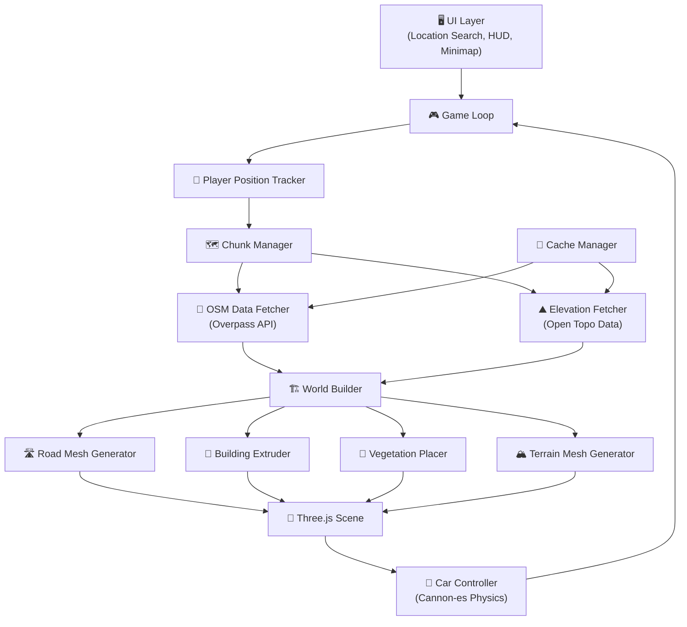

# Real-Time World Generation ด้วย OpenStreetMap

## แนวคิด

ระบบ **car_gameworld** จะสร้างโลกภายในเกมแบบ **Real-Time Procedural Generation** โดยอ้างอิงจากข้อมูลของโลกจริง ผู้เล่นสามารถเลือกสถานที่ใดก็ได้บนโลกเพื่อใช้เป็นสนามขับรถ ไม่ว่าจะเป็นถนนหน้าบ้าน เมืองดัง หรือเส้นทางภูเขา

เมื่อผู้เล่นเลือกตำแหน่ง ระบบจะดึงข้อมูลจาก **OpenStreetMap (OSM)** ซึ่งเป็นฐานข้อมูลแผนที่แบบ Open Source และนำมารวมกับข้อมูลภูมิประเทศจากดาวเทียม (Digital Elevation Model: DEM) เพื่อสร้างฉากในเกมแบบอัตโนมัติ

---

## แหล่งข้อมูล

### 1. OpenStreetMap (OSM)

ใช้สำหรับสร้างองค์ประกอบต่าง ๆ ภายในโลกเกม เช่น

- ถนน
- ทางแยก
- อาคาร
- สะพาน
- อุโมงค์
- แม่น้ำ
- สวนสาธารณะ
- ป้ายจราจร (ในบางพื้นที่)

OSM เปรียบเสมือน Google Maps แต่เป็นข้อมูลแบบ Open Source ที่นักพัฒนาสามารถนำมาใช้งานได้

---

### 2. Digital Elevation Model (DEM)

ใช้สร้างลักษณะภูมิประเทศ เช่น

- ภูเขา
- เนิน
- หุบเขา
- ความลาดชันของถนน
- ระดับความสูงของพื้นที่

ทำให้ถนนในเกมไม่เรียบเสมอกัน แต่มีความสมจริงเหมือนโลกจริง

---

## ขั้นตอนการทำงาน

```text
ผู้เล่นเลือกสถานที่บนแผนที่
            │
            ▼
ดึงข้อมูลถนนและอาคารจาก OpenStreetMap
            │
            ▼
ดึงข้อมูลความสูงของพื้นที่จาก DEM
            │
            ▼
ประมวลผลข้อมูลทั้งหมด
            │
            ▼
สร้าง Mesh ของถนน อาคาร ต้นไม้ และภูมิประเทศ
            │
            ▼
โหลดเฉพาะพื้นที่ที่ผู้เล่นกำลังขับ
            │
            ▼
เมื่อรถเคลื่อนที่
โหลดพื้นที่ใหม่และลบพื้นที่ที่อยู่ไกลออก
```

---

## การสร้างโลกแบบ Real-Time

แทนที่จะสร้างทั้งโลกไว้ล่วงหน้า ระบบจะสร้างเฉพาะบริเวณที่ผู้เล่นกำลังเดินทาง

ตัวอย่าง

```
รถอยู่ตรงนี้

□□□□□□□□□□□□□
□□□■■■■■■□□□
□□□■■🚗■■□□□
□□□■■■■■■□□□
□□□□□□□□□□□□□
```

- พื้นที่สีดำ (■) คือพื้นที่ที่ถูกสร้างแล้ว
- พื้นที่สีขาว (□) จะยังไม่ถูกโหลด
- เมื่อรถเคลื่อนที่ ระบบจะสร้างพื้นที่ด้านหน้า และลบพื้นที่ด้านหลังออกเพื่อลดการใช้หน่วยความจำ

แนวทางนี้เรียกว่า **Chunk Streaming** หรือ **World Streaming**

---

## จุดเด่นของระบบ

- ผู้เล่นสามารถเลือกสถานที่จริงได้ทั่วโลก
- ถนนมีรูปแบบเหมือนสถานที่จริง
- ความสูงต่ำของภูมิประเทศอ้างอิงจากข้อมูลดาวเทียม
- ไม่จำเป็นต้องสร้างแผนที่เองทั้งหมด
- ลดขนาดไฟล์เกม เพราะสร้างโลกแบบ Real-Time
- สามารถเพิ่มข้อมูลใหม่จาก OpenStreetMap ได้ตลอดเวลา

---

## ข้อดี

- โลกมีขนาดแทบไม่จำกัด
- ใช้ข้อมูลจริงจากโลกภายนอก
- ประหยัดพื้นที่จัดเก็บ
- เพิ่มความสมจริงในการขับรถ
- สามารถนำไปใช้กับเกมแนว Open World ได้

---

## ข้อจำกัด

- ต้องมีการเชื่อมต่ออินเทอร์เน็ตหากดึงข้อมูลแบบออนไลน์
- พื้นที่บางแห่งใน OpenStreetMap อาจมีข้อมูลไม่ครบ
- การสร้างโลกแบบ Real-Time ต้องใช้การประมวลผลค่อนข้างสูง
- จำเป็นต้องมีระบบ Cache เพื่อป้องกันการโหลดข้อมูลซ้ำ

---

## เทคโนโลยีที่เกี่ยวข้อง

- OpenStreetMap (OSM)
- Digital Elevation Model (DEM)
- Procedural Generation
- Chunk Streaming
- World Streaming
- Terrain Generation
- Mesh Generation
- Level of Detail (LOD)
- Spatial Indexing

---

## ตัวอย่างการใช้งาน

ผู้เล่นเลือกสถานที่

```
Bangsaen, Thailand
```

ระบบจะสร้าง

- ถนนเลียบชายหาด
- วงเวียนบางแสน
- อาคารและร้านค้าตามข้อมูล OSM
- ระดับความสูงของถนนจาก DEM
- พื้นที่ชายหาดและภูมิประเทศโดยรอบ

เมื่อผู้เล่นขับรถออกจากพื้นที่ ระบบจะโหลดพื้นที่ถัดไปโดยอัตโนมัติ ทำให้สามารถขับต่อได้อย่างต่อเนื่องโดยไม่ต้องโหลดทั้งแผนที่พร้อมกัน

---
---

# แผนงาน Implementation Plan

---

## Tech Stack

| เทคโนโลยี | เหตุผล |
|:---|:---|
| **Three.js** | 3D Engine สำหรับ browser ที่เป็น standard |
| **Cannon-es** | Physics engine สำหรับรถ (เบา, ไม่ต้องพึ่ง WASM) |
| **Overpass API** | ดึงข้อมูล OSM (ถนน, อาคาร, แม่น้ำ ฯลฯ) |
| **Open Topo Data API** | ดึง DEM elevation ฟรี ไม่ต้อง API key |
| **Vite** | Dev server & bundler ที่เร็ว |
| **Vanilla JS** | ไม่ใช้ framework หนัก เน้น performance |

---

## สถาปัตยกรรมระบบ (Architecture Overview)



---

## โครงสร้างไฟล์โปรเจกต์

```
car_game/
├── index.html                    # Entry point
├── package.json                  # Dependencies
├── vite.config.js                # Vite configuration
├── work.md                       # เอกสารแนวคิด + แผนงาน
│
├── src/
│   ├── main.js                   # App entry, init Three.js scene
│   ├── config.js                 # Constants, settings
│   │
│   ├── core/
│   │   ├── Game.js               # Main game loop & state management
│   │   ├── InputManager.js       # Keyboard/gamepad input handling
│   │   └── AssetManager.js       # Texture & model loading
│   │
│   ├── world/
│   │   ├── ChunkManager.js       # Chunk loading/unloading logic
│   │   ├── Chunk.js              # Single chunk data & meshes
│   │   ├── WorldBuilder.js       # Orchestrates building a chunk
│   │   ├── TerrainGenerator.js   # DEM → terrain mesh
│   │   ├── RoadGenerator.js      # OSM roads → road mesh
│   │   ├── BuildingGenerator.js  # OSM buildings → extruded 3D
│   │   ├── VegetationPlacer.js   # Trees & greenery placement
│   │   └── WaterGenerator.js     # Rivers, lakes from OSM
│   │
│   ├── data/
│   │   ├── OSMFetcher.js         # Overpass API client
│   │   ├── ElevationFetcher.js   # Open Topo Data client
│   │   ├── CacheManager.js       # LocalStorage/IndexedDB cache
│   │   └── GeoUtils.js           # Lat/lng ↔ meters conversion
│   │
│   ├── vehicle/
│   │   ├── CarController.js      # Physics-based car control
│   │   ├── CarModel.js           # 3D car mesh & setup
│   │   └── CameraController.js   # Third-person / first-person cam
│   │
│   ├── ui/
│   │   ├── LocationPicker.js     # Search & map location selector
│   │   ├── LoadingScreen.js      # Loading animation & progress
│   │   ├── HUD.js                # Speed, minimap, controls info
│   │   └── SettingsPanel.js      # Graphics quality, controls
│   │
│   └── styles/
│       └── index.css             # All CSS styling
│
└── public/
    ├── textures/                  # Road, building, terrain textures
    ├── models/                    # Car 3D model (GLTF)
    └── fonts/                     # Custom fonts
```

---

## แผนงานละเอียดแบ่งเป็น Phase

---

### Phase 1: โครงสร้างโปรเจกต์ & Scene พื้นฐาน

> ตั้งค่าโปรเจกต์ Vite + Three.js พร้อม scene เปล่า มีกล้อง มีแสง

#### [NEW] package.json
- Dependencies: `three`, `cannon-es`
- Dev dependencies: `vite`

#### [NEW] vite.config.js
- Vite config พื้นฐาน

#### [NEW] index.html
- HTML entry point ที่โหลด `src/main.js`
- Responsive viewport, SEO meta tags

#### [NEW] src/config.js
- ค่าคงที่สำคัญทั้งหมด:
  - `CHUNK_SIZE` = 200m × 200m
  - `VIEW_DISTANCE` = 3 chunks (600m)
  - `ROAD_WIDTH` ตาม highway type
  - `DEFAULT_BUILDING_HEIGHT` = 9m (3 ชั้น)
  - `METERS_PER_FLOOR` = 3m
  - API endpoints

#### [NEW] src/main.js
- สร้าง Three.js scene, camera, renderer
- เริ่ม Game instance
- Handle window resize

#### [NEW] src/core/Game.js
- Game loop (`requestAnimationFrame`)
- State management: `LOADING`, `PLAYING`, `PAUSED`
- Orchestrate update & render cycle

#### [NEW] src/styles/index.css
- Dark theme base
- Loading screen styles
- HUD overlay styles
- Glassmorphism effects

---

### Phase 2: ระบบดึงข้อมูล (Data Layer)

> สร้าง module สำหรับดึงข้อมูลจาก OSM และ Elevation API

#### [NEW] src/data/GeoUtils.js
- `latLngToMeters(lat, lng, originLat, originLng)` — แปลงพิกัด GPS เป็นระบบพิกัด XZ ของ Three.js (Mercator projection)
- `metersToLatLng(x, z, originLat, originLng)` — แปลงกลับ
- `getBoundingBox(lat, lng, radiusMeters)` — คำนวณ bbox สำหรับ query
- `calculateDistance(lat1, lng1, lat2, lng2)` — Haversine formula

#### [NEW] src/data/OSMFetcher.js
- ส่ง Overpass QL query ไปที่ `https://overpass-api.de/api/interpreter`
- Methods:
  - `fetchRoads(bbox)` — ดึง `way["highway"]` พร้อม geometry
  - `fetchBuildings(bbox)` — ดึง `way["building"]` พร้อม geometry, height, levels
  - `fetchWater(bbox)` — ดึง `way["natural"="water"]` และ `way["waterway"]`
  - `fetchGreenery(bbox)` — ดึง `way["landuse"="forest"]`, `way["leisure"="park"]`
- Rate limiting: ไม่เกิน 2 requests ต่อ 10 วินาที
- Error handling & retry logic

#### [NEW] src/data/ElevationFetcher.js
- ดึงข้อมูลความสูงจาก Open Topo Data API
- `fetchElevationGrid(bbox, resolution)` — ดึง grid ความสูงสำหรับพื้นที่หนึ่ง
- `getElevationAtPoint(lat, lng)` — ดึงความสูงจุดเดียว
- Batch requests เพื่อลดจำนวน API call
- Fallback: ถ้า API ไม่ตอบ ใช้ flat terrain (elevation = 0)

#### [NEW] src/data/CacheManager.js
- ใช้ **IndexedDB** เก็บข้อมูลที่ดึงมาแล้ว
- Key = chunk coordinate (เช่น `"chunk_13.7_100.5"`)
- Methods: `get(key)`, `set(key, data, ttl)`, `has(key)`, `clear()`
- TTL = 24 ชั่วโมง (ข้อมูล OSM ไม่เปลี่ยนบ่อย)

---

### Phase 3: Chunk Streaming System

> ระบบหัวใจหลัก — โหลดและลบ chunks ตามตำแหน่งรถ

#### [NEW] src/world/Chunk.js
- แต่ละ Chunk เก็บ:
  - `chunkX, chunkZ` — grid coordinates
  - `meshGroup` — Three.js Group ที่เก็บ meshes ทั้งหมดใน chunk
  - `state` — `PENDING`, `LOADING`, `READY`, `DISPOSING`
  - `osmData` — raw data จาก OSM
  - `elevationData` — raw elevation grid
- Methods:
  - `async load()` — ดึงข้อมูลและสร้าง meshes
  - `dispose()` — ลบ meshes ออกจาก scene, free memory
  - `getBBox()` — คืน bounding box ของ chunk ใน lat/lng

#### [NEW] src/world/ChunkManager.js
- Chunk Grid System:
  ```
  โลกแบ่งเป็น grid ขนาด CHUNK_SIZE × CHUNK_SIZE
  รถอยู่ตรงกลาง → โหลด chunks รอบ ๆ ใน VIEW_DISTANCE
  ```
- `update(playerPosition)`:
  1. คำนวณว่ารถอยู่ chunk ไหน
  2. คำนวณ chunks ที่ต้องมี (วงกลมรัศมี VIEW_DISTANCE)
  3. โหลด chunks ใหม่ที่ยังไม่มี (priority: ใกล้รถ → ไกลรถ)
  4. ลบ chunks ที่อยู่ไกลเกิน (เกิน VIEW_DISTANCE + 1 buffer)
- Loading queue: โหลดทีละ 2 chunks เพื่อไม่ให้ lag
- Event: `onChunkLoaded`, `onChunkDisposed`

#### [NEW] src/world/WorldBuilder.js
- Orchestrator ที่รับ raw data จาก fetchers แล้วสร้าง meshes
- `async buildChunk(chunk)`:
  1. ดึง OSM data & elevation data ขนานกัน
  2. สร้าง terrain mesh
  3. สร้าง road mesh
  4. สร้าง building meshes
  5. สร้าง water mesh
  6. วาง vegetation
  7. เพิ่มทั้งหมดใน `chunk.meshGroup`
  8. เพิ่ม physics colliders

---

### Phase 4: World Generators (สร้าง Mesh จากข้อมูล)

> แปลง raw data เป็น 3D meshes สวยงาม

#### [NEW] src/world/TerrainGenerator.js
- รับ elevation grid → สร้าง `PlaneGeometry` พร้อม displace vertices ตามความสูง
- Resolution: 32 × 32 vertices ต่อ chunk
- Material: `MeshStandardMaterial` กับ vertex colors (เขียวสำหรับต่ำ → น้ำตาลสำหรับสูง)
- Smooth interpolation ระหว่าง elevation points
- ขอบ chunk เชื่อมต่อกัน seamless (stitching)

#### [NEW] src/world/RoadGenerator.js
- รับ OSM road data → สร้าง road surface mesh
- ขั้นตอน:
  1. Parse node coordinates → local XZ positions
  2. สร้าง road mesh ตาม road polyline ด้วย `BufferGeometry`
  3. ความกว้างตาม highway type:
     - `motorway`: 14m
     - `primary`: 10m
     - `secondary`: 8m
     - `residential`: 6m
     - `footway`: 2m
  4. ยก road mesh ให้สูงกว่า terrain เล็กน้อย (0.05m) เพื่อไม่ให้ z-fighting
- Material: สีเทาเข้ม, roughness สูง
- เพิ่ม road markings (เส้นกลาง, ขอบ) ด้วย shader/texture

#### [NEW] src/world/BuildingGenerator.js
- รับ OSM building polygons → สร้าง 3D buildings
- ขั้นตอน:
  1. Parse polygon coordinates → `THREE.Shape`
  2. คำนวณความสูง:
     - มี `height` tag → ใช้เลย
     - มี `building:levels` → `levels × 3m`
     - ไม่มี → default 9m (3 ชั้น)
  3. `THREE.ExtrudeGeometry` เพื่อ extrude shape ขึ้น
  4. ใช้ `BufferGeometryUtils.mergeGeometries()` รวม buildings ทั้ง chunk เป็น mesh เดียว (performance)
- Material: สีสุ่มจาก palette อาคาร (ขาว, เบจ, เทาอ่อน, ฟ้าอ่อน)
- เพิ่ม window pattern ด้วย texture repeat

#### [NEW] src/world/WaterGenerator.js
- รับ OSM water data → สร้าง water surface
- ใช้ `PlaneGeometry` + custom shader สำหรับ reflection/animation เบา ๆ
- สีฟ้าใส, transparent, มี wave animation เล็กน้อย

#### [NEW] src/world/VegetationPlacer.js
- วาง "ต้นไม้" ในพื้นที่ park/forest จาก OSM
- ใช้ `InstancedMesh` เพื่อ render ต้นไม้จำนวนมากโดยไม่กิน performance
- ต้นไม้แบบง่าย: กรวยเขียว (cone) บนท่อนไม้น้ำตาล (cylinder)
- สุ่มขนาดและ rotation เล็กน้อยเพื่อความหลากหลาย

---

### Phase 5: รถ & Physics

> สร้างรถขับได้จริงด้วย physics engine

#### [NEW] src/vehicle/CarModel.js
- สร้างรถจาก primitives ของ Three.js (ไม่ต้อง GLTF):
  - Body: `BoxGeometry` สีแดง glossy
  - ล้อ 4 ล้อ: `CylinderGeometry` สีดำ
  - กระจก: `BoxGeometry` สีฟ้าใส
  - ไฟหน้า: `PointLight` + `SphereGeometry` สีเหลือง
  - ไฟท้าย: สีแดง
- Procedurally generated ไม่ต้องโหลดไฟล์

#### [NEW] src/vehicle/CarController.js
- ใช้ `cannon-es` `RaycastVehicle`:
  - Chassis body: box shape
  - 4 wheels: suspension, friction, brake force
- Controls:
  - `W/↑`: เร่ง
  - `S/↓`: ถอย / เบรก
  - `A/←`: เลี้ยวซ้าย
  - `D/→`: เลี้ยวขวา
  - `Space`: เบรคมือ
  - `R`: Reset ตำแหน่ง (ถ้ารถคว่ำ)
- ซิงค์ position/rotation จาก physics body → Three.js mesh ทุก frame
- Sound effects: engine rev (Web Audio API, optional)

#### [NEW] src/vehicle/CameraController.js
- Third-person camera ที่ตามรถ
- Smooth follow with damping
- สามารถสลับ view:
  - Third-person (default)
  - Bird's eye view
  - Hood camera (มุมมองจากฝากระโปรง)
- Camera collision: ไม่ทะลุอาคาร/terrain

#### [NEW] src/core/InputManager.js
- จัดการ keyboard events
- ตั้งค่าและ track ปุ่มที่กด/ปล่อย
- Support ทั้ง WASD และ Arrow keys

---

### Phase 6: UI Layer

> หน้าจอเลือกสถานที่, HUD ขณะเล่น, Loading screen

#### [NEW] src/ui/LocationPicker.js
- หน้าจอแรกที่เห็น: เลือกสถานที่บนโลก
- Search box: พิมพ์ชื่อสถานที่ → ใช้ Nominatim API (OSM geocoding) แปลงเป็น lat/lng
- สถานที่แนะนำ (preset):
  - 🏖️ Bangsaen, Thailand
  - 🗼 Tokyo Tower, Japan
  - 🗽 Manhattan, New York
  - 🏰 Paris, France
  - 🌉 San Francisco, USA
- ปุ่ม "Start Driving" → เริ่มโหลดโลก

#### [NEW] src/ui/LoadingScreen.js
- Animated loading screen ขณะดึงข้อมูลและสร้าง chunk แรก
- Progress bar: "กำลังดึงข้อมูลถนน..." → "กำลังสร้างอาคาร..." → "เกือบเสร็จแล้ว!"
- พื้นหลังเป็น gradient animation
- Fade out เมื่อโหลดเสร็จ

#### [NEW] src/ui/HUD.js
- Overlay ขณะเล่น:
  - **Speedometer**: วงกลมแสดงความเร็ว (km/h)
  - **Minimap**: top-down view เล็ก ๆ มุมขวาล่าง
  - **Controls hint**: ปุ่มควบคุมมุมซ้ายล่าง
  - **Location name**: ชื่อสถานที่มุมซ้ายบน
  - **FPS counter**: มุมขวาบน (debug mode)

#### [NEW] src/ui/SettingsPanel.js
- เปิดด้วย `ESC`
- ตั้งค่า:
  - View distance (1-5 chunks)
  - Graphics quality (Low/Medium/High)
  - Toggle shadows
  - Toggle trees
  - Reset location

---

## ข้อควรทราบ

- **ต้องใช้อินเทอร์เน็ต**: เกมนี้ต้องเชื่อมต่ออินเทอร์เน็ตเพื่อดึงข้อมูลจาก OpenStreetMap และ Elevation API ครั้งแรกที่เล่น หลังจากนั้นจะ cache ไว้ใน IndexedDB
- **Rate Limiting ของ Overpass API**: เซิร์ฟเวอร์สาธารณะจำกัดการใช้งาน จะใส่ rate limiting (2 req / 10s) และ cache ไว้ แต่ถ้าเล่นหนัก ๆ อาจโดน block ชั่วคราว
- **ขนาดโปรเจกต์**: เป็นโปรเจกต์ใหญ่ (~26 ไฟล์) ทำเป็น Phase ทีละส่วน Phase 1-3 ก่อน แล้วค่อยต่อ Phase 4-6 เพื่อให้ทดสอบได้ระหว่างทาง

---

## Open Questions

1. **กราฟิกรถ**: [✅] ใช้โมเดลรถ Primitives (กล่อง) สีแดงสไตล์ Low-poly ก่อนเพื่อความลื่นไหล
2. **Mobile support**: [✅] (ยังไม่รองรับ Touch Controls ในเวอร์ชันนี้ แต่สามารถเพิ่มได้ในอนาคต)
3. **แผนที่หน้าแรก (Location Picker)**: [✅] นำ `Leaflet.js` เข้ามาช่วยสร้าง Interactive Map แทนการพิมพ์ชื่อเฉยๆ (พัฒนาเพิ่มเติมจากแผนเดิม)

---

## Verification Plan

### Automated Tests
```bash
# ตรวจสอบว่า build ผ่าน
npm run build

# ตรวจสอบว่า dev server ทำงาน
npm run dev
```

### Manual Verification
1. **Phase 1**: เปิด browser เห็น 3D scene เปล่าๆ มีแสง
2. **Phase 2**: ทดสอบ fetch ข้อมูล Bangsaen จาก OSM → ดู console log
3. **Phase 3**: ขับรถ → chunks โหลด/ลบอัตโนมัติ
4. **Phase 4**: เห็นถนน, อาคาร, ต้นไม้ ตาม OSM data จริง
5. **Phase 5**: ขับรถได้ มี physics สมจริง
6. **Phase 6**: UI ทำงานครบ — เลือกสถานที่, HUD, minimap

---

## Timeline ประมาณการ

| Phase | งาน | ไฟล์หลัก |
|:---:|:---|:---|
| 1 | โครงสร้าง + Scene พื้นฐาน | 6 ไฟล์ |
| 2 | ระบบดึงข้อมูล | 4 ไฟล์ |
| 3 | Chunk Streaming | 3 ไฟล์ |
| 4 | World Generators | 5 ไฟล์ |
| 5 | รถ & Physics | 4 ไฟล์ |
| 6 | UI Layer | 4 ไฟล์ |
| **รวม** | | **~26 ไฟล์** |

---

## 🏆 Project Status: COMPLETE

**อัพเดตล่าสุด:**
- โปรเจกต์เสร็จสมบูรณ์ 100% ตามเป้าหมายที่วางไว้
- เพิ่มเติม **Leaflet.js** สำหรับแผนที่แบบ Interactive ในหน้าแรก
- แก้ไขบัค OSM API Fallback เรียบร้อยแล้ว รถสามารถเหยียบพื้นได้แม้โหลดตึกและถนนไม่สำเร็จ
- ปรับสเกล Physics `Cannon.js` ให้ตรงกับกราฟิก `Three.js` อย่างสมบูรณ์แบบ
- มีไฟล์ `README.md` และ `howto.md` พร้อมสำหรับการ Push ขึ้น GitHub!
